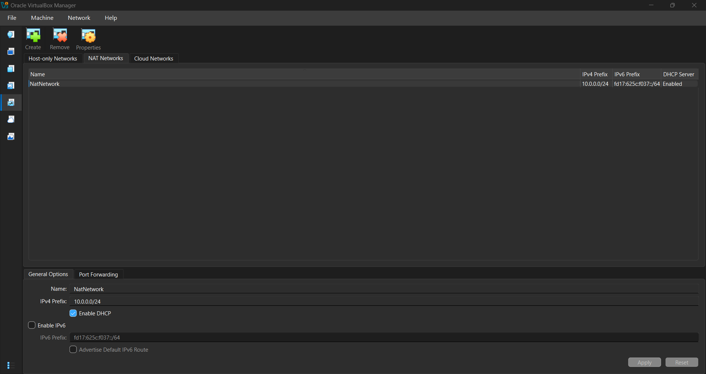
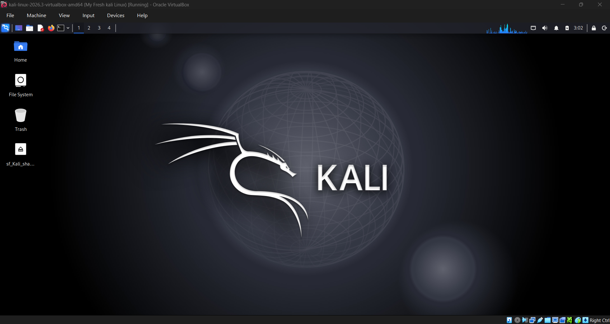
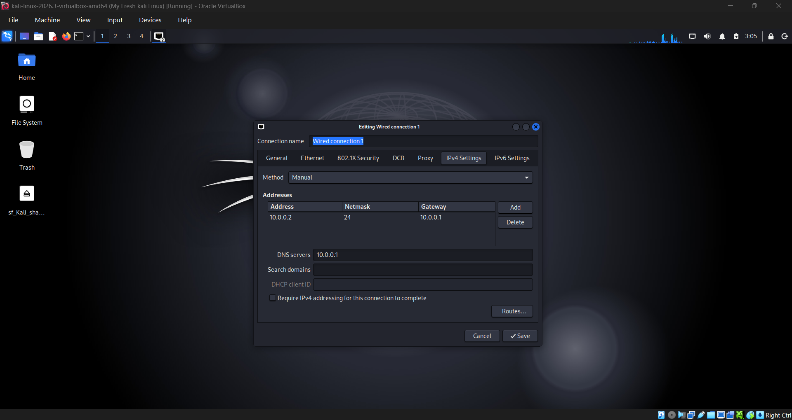
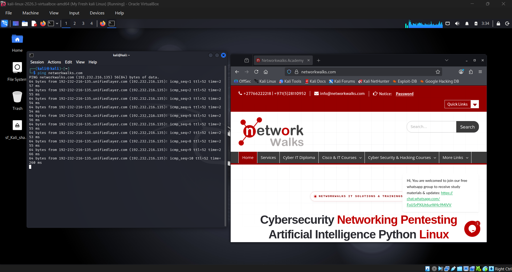

# 🔐 Cybersecurity Lab Environment Setup

> Building an isolated virtual lab for penetration testing and ethical hacking practice


---

## 📌 Project Overview

This project sets up a virtual cybersecurity and penetration-testing laboratory using **VirtualBox** and **Kali Linux**.

The lab provides a controlled environment where security tools, network scanning, reconnaissance and vulnerability assessment can be practised safely and repeatedly. It runs on a private virtual network so that additional machines can be added later as targets for authorized security testing.

---

## 🎯 Objectives

- Install and configure VirtualBox
- Import Kali Linux as a virtual machine
- Create a private NAT Network for the lab
- Configure network connectivity for Kali Linux
- Assign a consistent static IP address to the Kali VM
- Verify network connectivity and DNS resolution
- Take a clean VM snapshot for recovery
- Document the complete setup process
- Prepare the environment for future cybersecurity projects

---

## 🛡️ Purpose of the Lab

The lab is an isolated environment for learning and authorized security testing, including:

- Network reconnaissance
- Port scanning
- Vulnerability assessment
- Packet analysis
- Web security testing
- Exploitation practice
- Security-tool experimentation

> ⚠️ **Important:** Use this lab only on systems you own or have **explicit written permission** to test. Never use the lab or its tools against unauthorized systems.

---

## 🏗️ Lab Architecture

```
                 ┌──────────────────────────────┐
                 │   Host: Windows + VirtualBox │
                 └──────────────┬───────────────┘
                                │
                   NAT Network: 10.0.0.0/24
                   Gateway / DNS: 10.0.0.1
                                │
        ┌───────────────────────┼───────────────────────┐
        │                       │                       │
┌───────┴────────┐     ┌────────┴────────┐     ┌────────┴────────┐
│  Kali Linux    │     │  Target VM #1   │     │  Target VM #2   │
│  10.0.0.2/24   │     │  (future)       │     │  (future)       │
│  Attacker      │     │  10.0.0.3+      │     │  10.0.0.4+      │
└────────────────┘     └─────────────────┘     └─────────────────┘
```

Additional target machines can be added to the same virtual network in future projects.

---

## ⚙️ Lab Configuration

| Component | Configuration |
|---|---|
| 🖥️ Host OS | Windows |
| 🧰 Hypervisor | Oracle VirtualBox 7.2.22 |
| 🐉 Security OS | Kali GNU/Linux Rolling 2026.3 (`kali-linux-2026.3-virtualbox-amd64`) |
| 🧠 Kali RAM | 2048 MB |
| 🌐 Virtual Network | NAT Network (`NatNetwork`) |
| 📡 Network Address | 10.0.0.0/24 |
| 🐧 Kali IP Address | 10.0.0.2/24 |
| 🚪 Default Gateway | 10.0.0.1 |
| 🌍 DNS Server | 10.0.0.1 (VirtualBox NAT Network DNS proxy) |
| 🔮 Future VM Range | 10.0.0.3 – 10.0.0.99 |

---

## 🪜 Lab Setup Procedure

### Step 1. Install 7-Zip
7-Zip is used to extract the Kali Linux virtual-machine package, which is distributed as a `.7z` archive.

### Step 2. Install VirtualBox
VirtualBox **7.2.22** (`VirtualBox-7.2.22-r175245-Win.exe`) was installed as the hypervisor.

### Step 3. Create the NAT Network
A dedicated NAT Network was created in VirtualBox (**Tools → Network → NAT Networks**).

| Setting | Value |
|---|---|
| Network Name | `NatNetwork` |
| IPv4 Prefix | `10.0.0.0/24` |
| DHCP | Enabled |
| IPv6 | Disabled |

A NAT Network lets multiple VMs on the same virtual network talk to each other while still having outbound Internet access. This allows future attacker and target VMs to communicate inside the lab.

<p align="center"></p>

> The VirtualBox Host-only adapter (`192.168.56.1/24`) also exists by default on the host. It is not used by this lab.

### Step 4. Import Kali Linux
The Kali Linux VM was downloaded from the official Kali website and imported into VirtualBox.

```
Adapter 1
  Attached to:  NAT Network
  Name:         NatNetwork
  Adapter Type: Intel PRO/1000 MT Desktop
RAM: 2048 MB
```

A shared folder (`sf_Kali_shared`) was also configured for transferring files between the host and the Kali VM.

<p align="center"></p>

### Step 5. Configure the Kali Linux Network
The network was configured with a static IPv4 address using NetworkManager (**Edit Connections → Wired connection 1 → IPv4 Settings → Method: Manual**).

| Setting | Value |
|---|---|
| Address | `10.0.0.2` |
| Netmask | `24` (255.255.255.0) |
| Gateway | `10.0.0.1` |
| DNS servers | `10.0.0.1` |

A consistent IP address makes the lab easier to document and reference in future exercises.

<p align="center"></p>

### Step 6. Create a Clean VM Snapshot
After the initial configuration, a snapshot was taken:

```
Clean Kali - Network Setup
```

This is the clean baseline of the lab. If a future exercise breaks the VM, restore this snapshot.

---

## 🔎 Lab Verification

| Test | Command | Expected Result |
|---|---|---|
| 🌐 Check IP address | `ip a` | Kali shows `10.0.0.2/24` |
| 📡 Test gateway | `ping 10.0.0.1` | Successful replies |
| 🌍 Test Internet | `ping 8.8.8.8` | Successful replies |
| 🔎 Test DNS | `nslookup networkwalks.com` | Domain resolves |
| 🧰 Verify Nmap | `nmap --version` | Nmap version displayed |
| 🔄 Verify snapshot | Restore snapshot, run `ip a` | Baseline configuration restored |

### Example Result

`ping networkwalks.com` resolved the domain (to `192.232.216.135`) and returned replies with 0 packet loss, and the website loaded in Firefox, confirming both DNS and Internet connectivity from the Kali VM.

<p align="center"></p>

---

## 🐞 Problems Encountered & Solutions

### Problem 1. Internet connectivity after static IP configuration
After setting a static IPv4 address, Internet access may fail depending on the NetworkManager configuration. The workaround used was to disable the duplicate address detection timeout:

```bash
sudo nmcli connection modify "Wired connection 1" ipv4.dad-timeout 0
```

The connection was then restarted (or the VM rebooted) and connectivity re-tested.

> **Note:** Connection names differ between systems. List yours first with `nmcli connection show`.

### Problem 2. VirtualBox VT-x / virtualization error
The VM failed to start because hardware virtualization was disabled in the BIOS/UEFI. Fix:

1. Restart the computer
2. Enter BIOS/UEFI settings
3. Enable Intel VT-x / hardware virtualization
4. Save and restart
5. Start the Kali VM again

---

## 💡 What I Learned

1. **NAT vs NAT Network** – a NAT Network lets multiple VMs communicate with each other and still reach the Internet, which makes it ideal for a multi-machine lab.
2. **Virtual machine networking** – how VirtualBox adapters attach VMs to different network types.
3. **Static IP configuration** – setting and verifying IPv4 address, netmask, gateway and DNS in Kali Linux.
4. **VM snapshots** – take a clean snapshot before any risky or experimental work.
5. **Documentation** – recording commands, configuration, screenshots, problems and fixes is a core professional skill.

---

## 🔐 Security & Ethical Use

This laboratory is intended **strictly for educational purposes**. Only test systems you own or have explicit permission to test.

---

## 🔗 Tools & Resources

- 7-Zip: <https://7-zip.org/download.html>
- VirtualBox: <https://virtualbox.org/wiki/Downloads>
- Kali Linux: <https://kali.org/get-kali>

---

## 👤 Author

**Waqas Karim**
Cybersecurity Professional B082
LinkedIn: <https://www.linkedin.com/in/waqaskarim/>

---

## 📌 Project Information

| | |
|---|---|
| **Program** | Cybersecurity at Networkwalks |
| **Week** | 01 |
| **Project** | Cybersecurity & Pentesting Lab Setup |
| **Repository** | GitHub |

---

## 🗂️ Repository Structure

```
.
├── README.md
├── 1-Screenshot-Network-Settings.png
├── 2-Screenshot-kali-linux.png
├── 3-Kali-Linux-Network-Settings.png
└── 4-Kali-Linux-Network-Connection_Test.png
```
